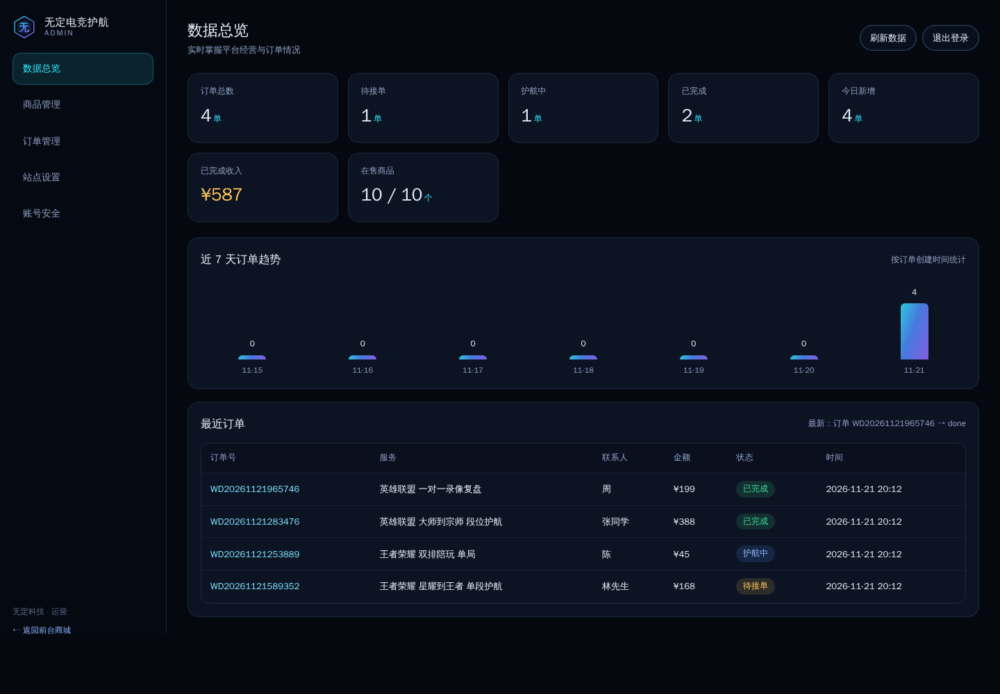
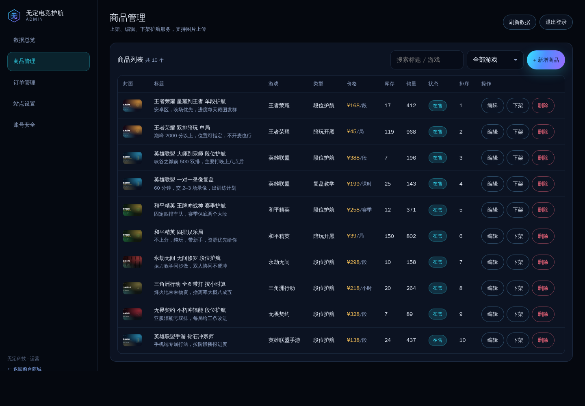
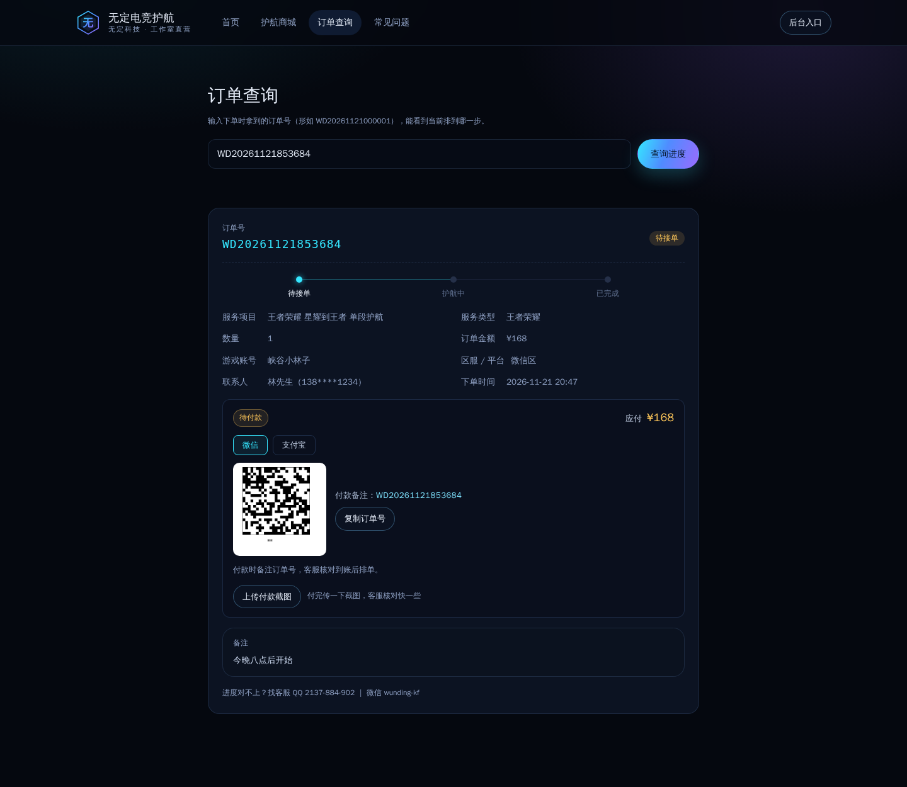
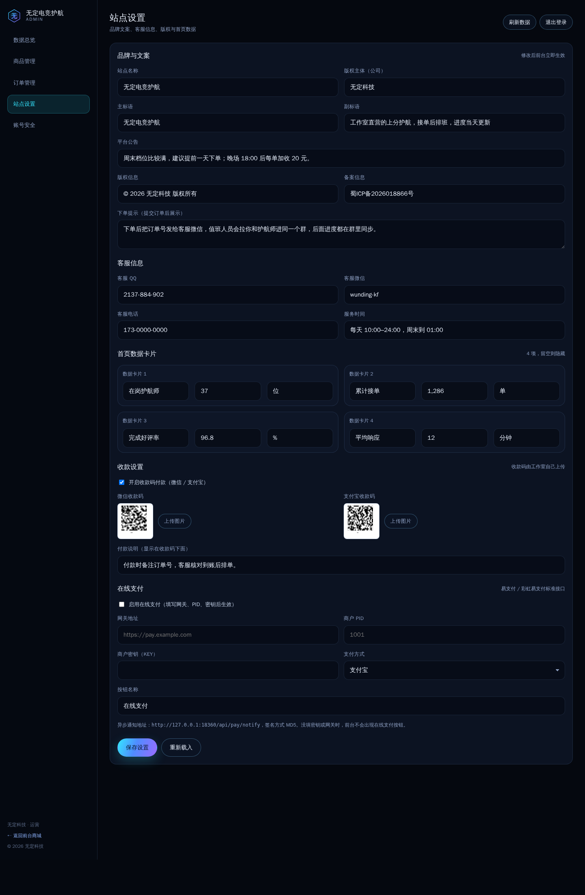

# 无定电竞护航

工作室自己在用的护航下单系统。前台是接单页，后台改价格、上架项目、看订单，不用装数据库，一个 JSON 文件就够了。

- 前台：项目列表、筛选、详情、下单、付款（收款码 / 在线支付）、订单进度查询
- 后台：登录、数据总览、商品增删改、封面图上传、订单接单/完成/取消、确认到账/退款、收款设置、站点文案
- 两套后端：Python（Termux / 小机器）和 Go（独立服务器），接口一致，数据文件通用
- 版权：© 无定科技

## 界面

| 前台 | 项目详情与下单 |
| --- | --- |
|  |  |

| 后台总览 | 商品管理 |
| --- | --- |
|  |  |

| 订单付款面板 | 后台收款设置 |
| --- | --- |
|  |  |

## 两种部署方式

| | Python 版 | Go 版 |
| --- | --- | --- |
| 适用 | Termux、树莓派、1 核小机器 | 独立服务器 |
| 依赖 | 系统自带 python3，不装 pip 包 | 无，单文件二进制 |
| 启动 | `python3 server-py/app.py` | `./wunding-escort` |
| 并发 | 一般，够小店用 | 好一些 |

两边读写同一个 `data/db.json`，字段、密码哈希、登录令牌都一致，换后端不用重新录数据，管理员密码也是同一个。

## 目录

```
wunding-escort/
├── web/                前台和后台的页面，纯静态，不用编译
├── server-py/          Python 后端（标准库）
│   ├── app.py          路由、静态文件、鉴权
│   ├── api.py          接口
│   ├── store.py        数据读写
│   ├── security.py     密码哈希、令牌
│   └── util.py
├── server-go/          Go 后端（标准库）
│   ├── main.go         路由和静态文件
│   ├── handlers.go     接口
│   ├── store.go        数据读写
│   ├── security.go
│   └── types.go
├── termux/             Termux 安装、前台跑、后台跑、停止
├── seed.json           第一次启动用的默认项目和文案，两端共用
├── start.sh            普通 Linux 启动（Python）
├── start-go.sh         普通 Linux 启动（Go）
├── scripts/            冒烟测试、打包脚本
└── deploy/             systemd / nginx 示例
```

## 手机上跑（Termux）

```bash
# 1. 装 Termux（F-Droid 或 GitHub 版本，应用商店那个太旧）
pkg update && pkg install -y git python

# 2. 拉代码
git clone https://github.com/<你的账号>/wunding-escort.git
cd wunding-escort

# 3. 前台跑，Ctrl+C 停
bash termux/run.sh

# 或者放后台跑
bash termux/bg.sh
bash termux/stop.sh
```

打开 `http://127.0.0.1:8080/`。同一个 WiFi 下，电脑用 `http://手机IP:8080/` 也能访问，手机 IP 在「设置 - 关于手机 - 状态信息」里看。

Termux 几个要注意的地方：

1. 装完执行一次 `termux-wake-lock`，不然锁屏后进程容易被系统杀掉（脚本里已经带了）。
2. 后台跑的时候别在最近任务里划掉 Termux，可以在系统设置里给 Termux 关掉电池优化。
3. 想在公网访问，最省事的是用 Cloudflare Tunnel（`pkg install cloudflared`，然后 `cloudflared tunnel --url http://127.0.0.1:8080`），不用折腾端口映射。
4. 数据在 `data/db.json`，图片在 `data/uploads/`，备份直接拷这个目录。

## 独立服务器（Go）

```bash
# 本机有 Go 的话
bash start-go.sh

# 或者直接下 Release 里的 linux-amd64 / arm64 包
unzip wunding-escort-go-2.0.0-linux-amd64.zip
cd wunding-escort-go-2.0.0-linux-amd64
SESSION_SECRET='换成一串随机字符' ./run.sh
```

systemd 示例在 `deploy/`，Nginx 反代也在里面。

## 独立服务器（Python）

```bash
unzip wunding-escort-python-2.0.0.zip
cd wunding-escort-python-2.0.0
SESSION_SECRET='换成一串随机字符' PORT=8080 ./run.sh
```

## 后台

地址 `/admin/`，默认账号 `wunding` / `wunding2026`。第一次进去先改密码，位置在「账号安全」。

环境变量：

| 变量 | 默认 | 说明 |
| --- | --- | --- |
| `PORT` | 8080 | 监听端口 |
| `HOST` | 0.0.0.0 | 监听地址，只给本机用就填 127.0.0.1 |
| `DATA_DIR` | data | 数据和上传图片放这里 |
| `ADMIN_USER` / `ADMIN_PASS` | wunding / wunding2026 | 只在第一次初始化时生效 |
| `SESSION_SECRET` | 内置默认值 | 线上一定要改，登录令牌用它签名 |

## 接口

| 方法 | 路径 | 说明 |
| --- | --- | --- |
| GET | `/api/site` | 站点信息、游戏和分类 |
| GET | `/api/products` | 项目列表，支持 game / category / q / sort |
| GET | `/api/products/{id}` | 项目详情 |
| POST | `/api/orders` | 下单，金额由服务端算 |
| GET | `/api/orders/{orderNo}` | 查订单，联系方式脱敏，带付款状态 |
| POST | `/api/orders/{orderNo}/proof` | 上传付款截图 |
| POST | `/api/orders/{orderNo}/pay` | 生成在线支付链接 |
| GET/POST | `/api/pay/notify` | 易支付异步通知，验签后记账 |
| GET | `/api/pay/return` | 支付完成跳回订单页 |
| POST | `/api/admin/login` | 登录，返回 12 小时令牌 |
| GET | `/api/admin/overview` | 总览数据 |
| GET/POST | `/api/admin/products` | 商品列表 / 新增 |
| PUT/DELETE | `/api/admin/products/{id}` | 改 / 删 |
| GET | `/api/admin/orders` | 订单列表 |
| PUT/DELETE | `/api/admin/orders/{id}` | 改状态 / 删 |
| GET/PUT | `/api/admin/settings` | 站点设置 |
| POST | `/api/admin/upload` | 上传封面（base64） |
| POST | `/api/admin/password` | 改密码 |

后台接口带 `Authorization: Bearer <token>`。

## 测试和打包

```bash
bash scripts/smoke.sh python     # 起服务跑一遍下单流程
bash scripts/smoke.sh go
bash scripts/package-py.sh       # dist/wunding-escort-python-*.zip
bash scripts/package-go.sh       # dist/wunding-escort-go-*-linux-*.zip
```

GitHub Actions（`.github/workflows/release.yml`）会分别测两套后端，然后打包上传；推 `v*` tag 时自动发 Release。产物在 Actions 页面或 Release 里都能下。

更细的部署步骤：Termux 看 [docs/TERMUX.md](docs/TERMUX.md)，服务器和 Nginx 看 [docs/DEPLOY.md](docs/DEPLOY.md)，收款和在线支付看 [docs/PAYMENT.md](docs/PAYMENT.md)。

## 说明

- 订单金额是后端按商品价格算的，前端改不动。
- 登录失败 10 分钟内超过 6 次会锁一会儿。
- 上传只收 PNG/JPG/WEBP/GIF，校验文件头，封面最大 5MB，付款截图 3MB。
- 在线支付走易支付标准接口，签名 MD5，回调会核对金额和交易状态；商户密钥只存服务端，前台接口拿不到。
- 没开在线支付也能用收款码：用户传截图，后台人工确认到账。
- 静态文件做了路径穿越检查，页面响应带 CSP。
- 这套系统按「工作室自用」的规模做的，日单量上百没问题；再往上建议换正式数据库。

## 版权

代码、页面和文案归无定科技所有。公开仓库只是为了方便部署和二次开发，不代表放弃著作权，具体见 [LICENSE](LICENSE)。

© 2026 无定科技
